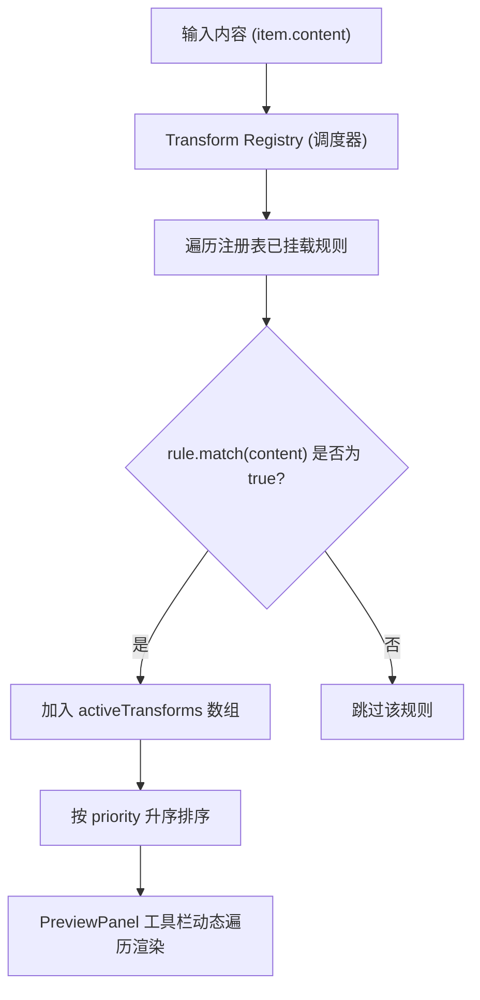
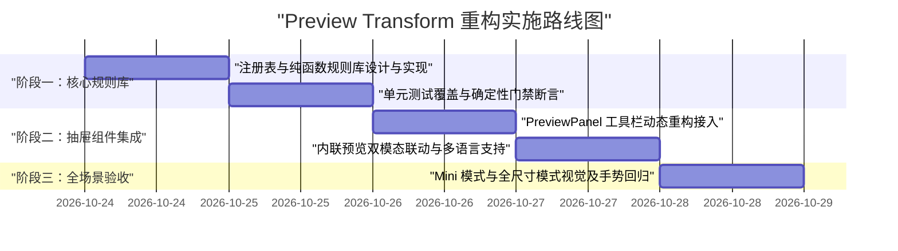

# 抽屉文本快捷转换注册表架构设计（Preview Transform Registry）

> 文档状态：方案就绪 / 准备重构  
> 目标模块：`src/components/Panel/PreviewPanel.jsx` 及 `src/utils/transforms/`  
> 关联文件：[`docs/plans/2026-03-14-preview-detail-unification-design.md`](docs/plans/2026-03-14-preview-detail-unification-design.md)

---

## 1. 背景与现状诊断

### 1.1 现状与已识别模式
当前 Qollect 的右侧抽屉（`PreviewPanel`）中已经具备了部分文本特征识别与转换能力：
1. **JSON 格式化**：检测到合法的 JSON 文本时，提供 `formatJsonCopy`（美化为 2 空格缩进并复制）；
2. **时间戳解析**：检测到 10/13 位合规 Unix 时间戳（`detectTimestampCandidate`）时，提供时间戳转换为本地可读日期的切换与复制；
3. **纯颜色识别**：识别 HEX、RGB、HSL 纯颜色文本（`parsePureColorText`）时，提供色块预览及多格式互转复制；
4. **cURL 命令**：识别 `curl` 请求命令（`isCurlCommand`）时，展开专属的 CurlBox 交互抽屉。

### 1.2 现存痛点：硬编码与低拓展性
尽管上述能力已在运行，但其工程实现存在明显的扩展性瓶颈：
- **逻辑强耦合且高度碎片化**：检测逻辑零散分布在 `formatters.js`、`curlParser.js` 和 `PreviewPanel.jsx` 内部；
- **JSX 机械堆砌**：`PreviewPanel.jsx` 内部通过一系列硬编码的 `if (isJson)`、`if (pureColorPreview)`、`if (shouldShowTimestampConvertButton)` 渲染具体按钮，每个动作都绑定了独立的 `useState` 和状态反馈；
- **关键高频方向缺失**：
  - JSON 只有“美化”而无“压缩为单行”（无法直接用于 CLI 参数或 Docker 环境变量）；
  - 缺少解决跨环境报错的底层清洗能力（终端提示符清洗、Windows 路径转义、Token 隐形换行脱水、URL 百分号解码、Unicode 转义还原等）；
- **难以无痛拓展**：未来若新增第 9 个、第 10 个场景，必须反复修改 `PreviewPanel.jsx` 的核心渲染树与状态流，极易引发 UI 回归与手势穿透漏洞。

---

## 2. 设计原则与核心目标

1. **注册表与插件化（Registry & Strategy Pattern）**：
   - 转换规则与 UI 彻底解耦。抽屉工具栏不写任何特定规则的业务逻辑，仅基于输入文本向注册表索取“当前命中的规则清单”并遍历渲染。
   - 新增、修改或删除一个转换规则，仅涉及规则注册文件与 i18n 字典，**核心 UI 组件零改动**。
2. **确定性判定门禁（Zero False-Positive Gate）**：
   - 每个规则必须具备清晰、排他的模式特征（通过纯正则或轻量解析器断言），坚决不搞模糊猜测，杜绝在普通文章或聊天记录中误弹按钮。
3. **零常态视觉干扰（Zero-Noise by Default）**：
   - 规则未命中时，卡片与抽屉工具栏保持绝对纯净；只有内容精准触发规则时，才在抽屉工具栏动态呈现对应的小药丸按钮。
4. **复制优先 + 所见即所得双模态（Copy & Inline Preview）**：
   - 基础操作统一为“一键转换并写入系统剪贴板（带勾选动画反馈）”；
   - 针对文本可读性改善的规则（如 Unicode 解码、URL 乱码解码、时间戳翻译），支持抽屉主内容区无缝在“原始文本”与“转换明文”之间切换预览。

---

## 3. 架构设计与契约标准

### 3.1 模块目录结构

```text
src/
└── utils/
    └── transforms/
        ├── index.js              # 注册表统一出口与调度引擎
        ├── types.js              # 规则契约与常量定义
        └── rules/
            ├── jsonRules.js      # JSON 美化与单行压缩
            ├── timestampRules.js # 时间戳与日期解析
            ├── unicodeRules.js   # \uXXXX Unicode 解码还原
            ├── terminalRules.js  # 终端命令提示符剥离
            ├── pathRules.js      # Windows 路径转 POSIX 正斜杠
            ├── tokenRules.js     # Token 隐形空白与断行脱水
            ├── urlRules.js       # URL 百分号乱码还原
            ├── envRules.js       # export KEY=VAL 剥离转 .env
            └── gitRules.js       # 40位 Git SHA 截取 7 位短 Hash
```

### 3.2 规则对象契约（Rule Schema）

每个规则模块必须实现如下标准接口：

```typescript
export interface TransformRule {
  /** 唯一标识符，用于 React key、复制反馈状态区分 */
  id: string;

  /** 图标组件（Lucide Icon） */
  icon: React.ComponentType<{ size?: number; className?: string }>;

  /** 按钮多语言文案 key，例如 'transforms.unicode' */
  labelKey: string;

  /** Tooltip 悬浮说明 key，例如 'transforms.unicodeTitle' */
  titleKey: string;

  /** 优先级排序（数字越小越靠前） */
  priority?: number;

  /**
   * 判定门禁：判断当前文本是否命中该规则
   * 必须是无副作用的纯函数，执行时间必须控制在 0.5ms 以内
   */
  match: (text: string, meta?: Record<string, unknown>) => boolean;

  /**
   * 执行转换：输出处理后的目标文本
   * 必须保证异常安全（内部 catch 或兜底返回原文本），禁止抛出未捕获异常
   */
  apply: (text: string, meta?: Record<string, unknown>) => string;

  /**
   * 是否支持所见即所得内联预览切换
   * true 时抽屉内容区支持直接切换显示转换后内容
   */
  previewable?: boolean;
}
```

### 3.3 调度引擎处理流程



---

## 4. 首批纳管与新增的完整规则矩阵

### 4.1 纳管与增强的原生能力（3 项）

| 规则 ID | 触发检测（Match） | 转换输出（Apply） | 预览切换 | 解决的核心痛点 |
| :--- | :--- | :--- | :---: | :--- |
| `json_pretty` | 合法 JSON 且为单行或紧凑排版 | `JSON.stringify(..., null, 2)` | 否 | 结构化快速美化与排版对齐（现有逻辑整合） |
| `json_compact` | 合法 JSON 且**包含换行符 `\n`** | `JSON.stringify(parsed)` 纯单行 | 否 | **新增**：美化配置转单行，专供 CLI 参数与环境变量 |
| `timestamp_convert` | 10 位或 13 位合规 Unix 时间戳 | 格式化本地日期 `YYYY-MM-DD HH:mm:ss` | 是 | 纳管现有时间戳转换逻辑，统一收归调度 |

### 4.2 新增的高频防报错清洗规则（8 项）

| 规则 ID | 触发检测（Match） | 转换输出（Apply） | 预览切换 | 解决的核心痛点 |
| :--- | :--- | :--- | :---: | :--- |
| `unicode_decode` | 包含 `\u[0-9a-fA-F]{4}` 转义序列 | 还原为正常中文与多语言字符 | 是 | 修复 Python/后端/微服务日志满屏 `\uXXXX` 无法肉眼辨识的问题 |
| `terminal_clean` | 行首包含 `$ `, `# `, `> ` 等命令提示符 | 剥离行首符号，输出直接可执行命令 | 否 | 彻底解决从文档复制代码贴进终端报 `command not found` 的问题 |
| `windows_path_posix` | 包含 Windows 盘符路径（`[a-zA-Z]:\`） | 反斜杠 `\` 转换为正斜杠 `/` | 否 | 彻底解决贴入 Git Bash / WSL / Linux 终端因反斜杠转义导致的路径失效 |
| `token_sanitize` | 匹配 Token 前缀或高熵密文且包含内部换行或首尾空格 | 剔除所有内部 `\r\n\t` 和首尾空格 | 否 | 防范富文本换行和双击误选尾随空格导致的 401 鉴权失败 |
| `url_decode` | 包含有效 `%[0-9A-Fa-f]{2}` 百分号编码 | `decodeURIComponent` 还原可读中文 | 是 | 彻底消灭从浏览器复制出的长串十六进制乱码链接与文件名 |
| `env_strip_export` | 包含多行 `export KEY=VAL` 声明 | 剔除所有行首 `export `，保留纯 `KEY=VAL` | 是 | 从 README / 博客复制代码直接转为 `.env` 配置文件格式 |
| `git_short_hash` | 严格匹配 40 位十六进制 SHA 字符串 | 截取前 7 位短 Hash | 否 | 提交 PR、写发版说明或日志沟通时免除手动退格截断 |

---

## 5. 抽屉（PreviewPanel）重构与交互规范

### 5.1 工具栏动态挂载（重构前 vs 重构后）

#### 重构前（硬编码反模式）：
```jsx
// ❌ 无法扩展，每加一个模式都需要堆砌 JSX
{isJson && (
  <button onClick={...}>格式化 JSON</button>
)}
{shouldShowTimestampConvertButton && (
  <button onClick={...}>转时间戳</button>
)}
// 无法容纳未来新增的 8~10 个规则
```

#### 重构后（注册表驱动）：
```jsx
// ✅ 一行钩子解析全部命中动作
const activeTransforms = useMemo(() => {
  if (!item?.content || item.type_ !== 'text') return [];
  return resolveMatchingTransforms(item.content);
}, [item?.content, item?.type_]);

// ✅ 动态循环渲染，样式完全复用已有 .preview-tool-btn 体系
{activeTransforms.map((rule) => {
  const IconComponent = rule.icon;
  const isCopied = copiedToolbarAction === rule.id;
  return (
    <button
      key={rule.id}
      type="button"
      className={`preview-tool-btn secondary ${isCopied ? 'copied' : ''}`}
      onClick={() => runToolbarCopyAction(rule.id, () => handleCopyPlainText(rule.apply(item.content), 'preview'))}
      title={t(rule.titleKey)}
    >
      {isCopied ? <Check size={14} /> : <IconComponent size={14} />}
      <span>{isCopied ? t('item.copied') : t(rule.labelKey)}</span>
    </button>
  );
})}
```

### 5.2 所见即所得内联预览（Previewable Rules）
针对支持 `previewable: true` 的规则（如 `unicode_decode`、`url_decode`、`timestamp_convert`）：
1. 在抽屉内容展示区上方保留一个通用的切换胶囊（Toggle Pill）：
   - `[原始文本]` / `[解码预览]`；
2. 用户点击切换后，预览文本区直接使用 `rule.apply(item.content)` 渲染，且高亮显示转换后的可读结果；
3. 用户再次双击或全局快捷键复制时，默认复制当前所见内容。

### 5.3 响应式布局门禁
- **Mini 模式（320x450）**：抽屉工具栏允许横向单行滚动或自动换行，按钮保持 `white-space: nowrap` 且内边距适配紧凑图标；
- **全尺寸模式（800x600+）**：工具栏右侧对齐，自适应排列，与原有的 AI 生成、分享、删除等主操作互不挤压。

---

## 6. 分阶段落地路线图



### 详细实施步骤：
1. **阶段一（纯函数规则引擎）**：
   - 新建 `src/utils/transforms/` 目录；
   - 编写首批 8 大清洗转换规则与 3 项纳管规则，确保无副作用；
   - 编写对应的单测用例，验证各种边界输入（空字符串、超长文本、特殊字符、转义符号）。
2. **阶段二（i18n 多语言补全）**：
   - 在 `src/i18n/locales/zh-CN.json` 和 `src/i18n/locales/en-US.json` 的 `transforms.*` 命名空间下补齐所有规则的按钮文案与 Tooltip。
3. **阶段三（抽屉接入与清理）**：
   - 改造 `src/components/Panel/PreviewPanel.jsx`；
   - 移除原先冗余的硬编码状态，接入 `resolveMatchingTransforms`；
   - 联调已有的复制反馈动画和内联展示。
4. **阶段四（发版与交付）**：
   - 跑通 `npm run build` 和 `npm run lint:styles:strict`；
   - 验证 Mini 模式与常规尺寸下零排版挤压；
   - 产出发版 Release Notes。
